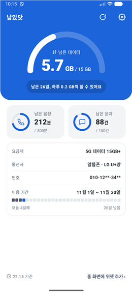
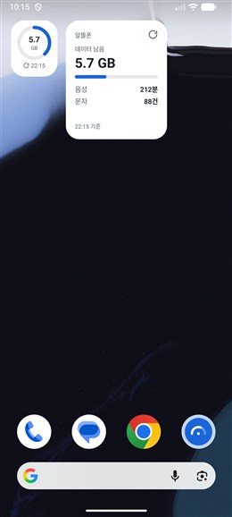
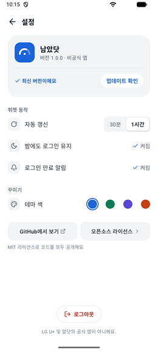

# 남았닷

알닷 남은 사용량을 홈 화면에서 바로 보는 Android 위젯

> [!NOTE]
> **비공식 앱이에요.** LG U+ 및 알닷과 관계가 없어요.
> 알닷 웹사이트([uplusmvno.com](https://www.uplusmvno.com))에 로그인하면 보이는 사용량을 가져와 보여 줘요.
> 알닷이 사이트를 바꾸면 갑자기 동작하지 않을 수 있어요.

| 앱 홈 | 홈 화면 위젯 | 설정 |
| :---: | :---: | :---: |
|  |  |  |

**[최신 버전 받기](https://github.com/Guest-01/aldot-widget/releases/latest)** · Android 8.0 이상

## 소개

남았닷은 알닷 회선의 남은 데이터·음성·문자를 홈 화면 위젯으로 보여 주는 앱이에요.

- **한눈에.** 위젯 3가지 크기(1×1, 2×1, 2×2)로 남은 양을 보여 줘요. 앱을 열면 하루에 쓸 수 있는 양과 이용 기간까지 보여요.
- **알아서.** 30분 또는 1시간마다 새 값을 가져와요. 2시간이면 풀리는 알닷 로그인도 중간중간 이어 줘요.
- **안심하고.** 아이디·비밀번호를 보지 않고, 알닷과 이 저장소(업데이트 확인) 말고는 어디에도 접속하지 않아요.

테마 색은 4가지 중에 고를 수 있고 앱과 위젯에 함께 적용돼요. 다크 모드는 폰 설정을 따라요.

## 설치

1. 폰에서 [최신 버전](https://github.com/Guest-01/aldot-widget/releases/latest)의 `.apk` 파일을 받아요.
2. 받은 파일을 열어 설치해요. 처음이면 브라우저나 '내 파일' 앱에 **출처를 알 수 없는 앱 설치**를 허용해야 해요.
3. 앱을 열어 알닷 계정으로 로그인해요. 이어서 알림·배터리·위젯을 차례로 안내해 줘요.

> [!TIP]
> **갤럭시(One UI 6 이상)** 에서는 '보안 위험 자동 차단'이 켜져 있으면 스토어 밖에서 받은 앱을 설치할 수 없어요.
> '설정 → 보안 및 개인정보 보호 → 보안 위험 자동 차단'을 잠시 끄고 설치한 뒤 다시 켜 주세요.
> 설치할 때 **Google Play 프로텍트** 창이 뜰 수 있어요. 여기서 '앱 설치 안함'을 누르면 설치되지 않아요.

### 밤에도 로그인이 유지되게 하려면

폰이 절전 중이면 로그인 연장이 늦어져 로그인이 풀릴 수 있어요.
첫 실행 안내나 '설정'의 **밤에도 로그인 유지 → 켜기**를 눌러 배터리 사용을 **제한 없음**으로 바꿔 주세요.

### 업데이트

앱이 하루 한 번 새 버전이 나왔는지 확인하고, 나오면 소리 없는 알림으로 알려 줘요.
'설정 → 앱 정보'에서 **지금 확인**으로 바로 확인할 수도 있어요.

- **바로 설치**를 누르면 앱이 새 버전을 받아 설치해요. 처음 한 번은 남았닷에 **출처를 알 수 없는 앱 설치**를 허용해야 해요. Android 12 이상에서는 그다음부터 확인 창 없이 설치돼요.
- **브라우저로 받기**를 누르거나, [최신 버전](https://github.com/Guest-01/aldot-widget/releases/latest)의 `.apk`를 직접 받아 설치해도 돼요.

어느 쪽이든 로그인과 설정은 그대로 남아요.

### 삭제

폰에서 앱을 지우면 로그인, 사용량, 설정이 모두 함께 지워져요. 남는 건 없어요.
지우기 전에 앱에서 **로그아웃**하면 알닷 로그인도 바로 끝나요.

## 개인정보

- **아이디·비밀번호는 앱이 보지 않아요.** 로그인은 앱 안에 띄운 알닷 로그인 화면에서 직접 해요.
- **폰 안에만 저장해요.** 로그인 쿠키, 마지막으로 가져온 사용량, 설정, 갱신 기록(시각과 성공·실패만)이에요.
- **백업하지 않아요.** 클라우드 백업과 기기 이전에서 빠지도록 막아 두었어요. 새 폰에서는 다시 로그인해 주세요.
- **알닷(uplusmvno.com)과 GitHub에만 접속해요.** GitHub에는 하루 한 번 새 버전이 있는지 묻고, 업데이트할 때 새 버전 파일을 받아요. 이때 로그인 정보나 사용량은 보내지 않아요.
- **광고, 분석 도구, 개발자 서버가 없어요.**

코드가 모두 공개되어 있어서 위 내용을 직접 확인할 수 있어요.

## 자주 묻는 질문

**로그인이 자꾸 풀려요.**
배터리 사용을 **제한 없음**으로 바꿔 주세요. [밤에도 로그인이 유지되게 하려면](#밤에도-로그인이-유지되게-하려면)을 참고해 주세요.

**위젯 값이 바로 안 바뀌어요.**
정해 둔 주기(30분 또는 1시간)마다 갱신해요. 위젯의 새로고침 버튼을 누르면 바로 가져와요.

**알닷 사이트와 숫자가 조금 달라요.**
위젯 아래에 마지막으로 가져온 시각이 나와요. 그 뒤에 쓴 양은 다음 갱신 때 반영돼요.
알닷에 늦게 반영되는 사용량은 앱에도 늦게 보여요.

**회선이 여러 개인데 하나만 보여요.**
지금은 계정의 첫 번째 회선만 보여 줘요.

**무제한 요금제도 되나요?**
아직 실제 화면으로 확인하지 못했어요. 남은 양이 이상하게 보이면 [알려 주세요](#문제가-생기면).

**왜 갱신 주기를 더 짧게 못 하나요?**
많은 사람이 자주 조회하면 알닷 서버에 부담이 돼요. 그래서 기본은 1시간, 가장 짧게는 30분이에요. 새로고침 버튼도 한 번 누르면 1분 동안 잠겨요.

## 문제가 생기면

[Issues](https://github.com/Guest-01/aldot-widget/issues)에 아래 내용을 적어 주세요.

- 폰 기종과 Android(One UI) 버전
- 앱 버전 ('설정 → 앱 정보'에 나와요)
- 어떤 화면에서 무슨 일이 있었는지

> [!IMPORTANT]
> Issues는 누구나 볼 수 있어요. 전화번호나 사용량이 보이는 캡처는 가려서 올려 주세요.

## 직접 빌드하기

[Android Studio](https://developer.android.com/studio)로 이 폴더를 열어 실행하거나 `./gradlew assembleDebug`로 빌드해요.
Kotlin, Jetpack Compose, Glance(위젯), WorkManager로 만들었어요.

### 릴리스 만들기

1. `app/build.gradle.kts`의 `versionCode`를 1 올리고 `versionName`을 바꿔요.
2. `release-notes.txt`에 바뀐 점을 한 줄에 하나씩 써요.
3. `./gradlew makeReleaseUpdate`를 실행하면 `app/build/outputs/update/release/`에 `aldot-widget-<버전>.apk`와 `update.json`이 생겨요.
4. GitHub에 `v<버전>` 태그로 릴리스를 만들고 두 파일을 첨부해요. 릴리스 설명에는 바뀐 점을 그대로 붙여 넣어요.

앱은 `releases/latest/download/update.json`을 읽어요. GitHub API는 쓰지 않아요(로그인 없이는 IP당 시간당 60번 제한).
다른 주소로 시험하려면 `-Paldot.updateUrl=<주소>`를 붙여 빌드해요.

## 라이선스

[MIT](LICENSE)

앱이 쓰는 오픈소스 라이브러리의 라이선스는 앱의 '설정 → 앱 정보 → 오픈소스 라이선스'에서 볼 수 있어요.
아이콘은 [Lucide](https://lucide.dev)(ISC License)를 썼어요.
